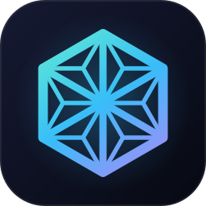

  

# Kumikit

A small, pluggable framework for working with coding agents.

- **Headless core, thin client.** A Rust core runs agents and holds your threads; the
  desktop app (system webview, no bundled browser) connects to it, and to remote cores on
  your other machines, in tabs side by side.
- **Plugins on both sides.** Agent providers, tools, bots, UI panels and themes are
  plugins. Core plugins run as sandboxed WebAssembly components with permissions you
  approve.
- **You choose what's installed.** A handful of plugins come preinstalled; everything else
  is your choice.
- **Light.** Low memory and CPU use by design.

The name comes from *kumiko*, Japanese woodwork in which a lattice is assembled from many
small pieces without nails.

> **Status:** early, pre-1.0 (`v0.1.0-m8.1`). Milestones M0–M8 are done: the core,
> WebAssembly plugins (WIT 0.2.0, `kumikit:tool@0.1.0`, `kumikit:turn@0.1.0`,
> `kumikit:threads@0.1.0`, `kumikit:session@0.1.0` and the MCP tool gateway), schedules,
> durable queues, steering, provider handoff, deferred messages, forks and side threads,
> the desktop app with borderless window chrome, resizable sidebars and split panes, remote
> cores over TLS or SSH (with verified matching core sync), the browser client, signed
> idle-safe application updates (`Settings → About` and `kumikit update`), package
> signing, the official plugin registry
> ([`kumikit/registry`](https://github.com/kumikit/registry)), bundled `provider-acp` and
> `threads` core plugins, and the first-party starter pack of providers and tools.
> Interfaces stay 0.x until the 1.0 freeze. Desktop installers (`.deb`, `.rpm`, `.AppImage`
> with CLI forwarding, `.dmg`, Windows `-setup.exe`; OS-unsigned, Ed25519-verified for
> in-app updates) and standalone CLI archives (with bundled `core-plugins/`) are published
> on [GitHub Releases](https://github.com/kumikit/kumikit/releases), or you can
> [build from source](docs/building.md). The specification is in
> [docs/spec/](docs/spec/README.md).

## Privacy

Kumikit has no accounts and no telemetry. It makes no network requests on its own. The
only traffic is what you start: agents you run, plugin registry lookups when you browse or
install, outgoing HTTPS hosts you explicitly grant a plugin in `permissions.network`, and
connections to cores you pair with.

Plugin registries are contacted only when you browse or search them, install or update
from them, import a lockfile or check for updates: a core contacts them for core plugins,
the desktop app for UI plugins and themes. Nothing is checked in the background, and the
first-run screen asks before it shows the registry's starter pack.

Application update checks (`Settings → About` and `kumikit update`) contact GitHub
(`raw.githubusercontent.com` and `github.com`) only when you ask, or periodically if you
explicitly opt into **Automatic updates** (off by default). Every release manifest is
verified against Kumikit's pinned Ed25519 public key before downloading, and automatic
updates install only after all agents are idle. SSH remote core sync downloads the matching
signed archive locally only when you confirm (or opt into SSH auto-sync) and streams it
over your existing `ssh` connection.

Plan limits in **Agent usage** come from what your agents report during turns. The
refresh button asks the provider to read them now, which runs the agent's own CLI (for
example `claude` or `agy`), and that CLI contacts its vendor with your sign-in. Nothing
refreshes on a timer. Usage statistics are counted from this core's own records and never
leave it.

A core listens on the network only when you start it with `kumikit serve --listen`; it
never turns that on by itself. The desktop app connects only to cores you added, over TLS
or through your own `ssh`, and sends keepalive pings only on those connections, so it
notices when a network goes away.

The desktop app shows web pages only from its own files: links in agent output are copied,
not opened, and markdown images are shown as text, so nothing is fetched from the web. On
Windows the app uses the system's WebView2, whose own diagnostic data follows your Windows
settings; the Windows installer carries the WebView2 bootstrapper, which downloads the
runtime only if it is missing when you install.

## Documentation

- [Building from source](docs/building.md): prerequisites and steps for Linux, macOS and
  Windows.
- [Remote connectivity](docs/remote.md): connecting to remote cores over TLS with pairing,
  through SSH, or via the browser client.
- [Specification](docs/spec/README.md): how Kumikit works.
- [Plugin templates](templates/README.md): start a core plugin (Rust), a UI plugin (Svelte)
  or a theme; sign it with `kumikit plugin keygen` and `kumikit plugin pack --key`.
- [Decisions](docs/decisions/README.md): why it works that way.
- [Contributing](CONTRIBUTING.md) and [AGENTS.md](AGENTS.md) (rules for humans and coding agents).
- [Security](SECURITY.md).

## License

[MIT](LICENSE).

## Links

- Website: <https://kumikit.dev>
- Source: <https://github.com/kumikit>
- Official plugin registry: <https://github.com/kumikit/registry>
